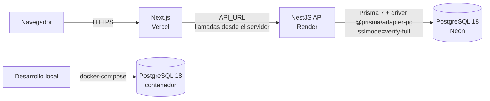
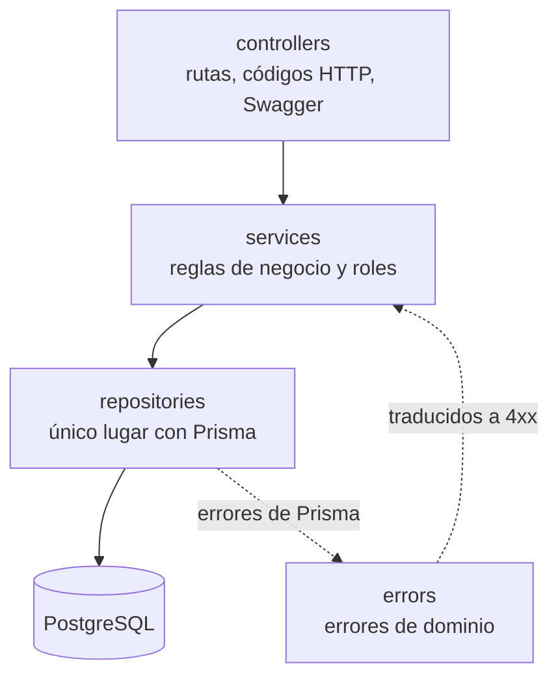

# 2. Arquitectura

## 2.1 Componentes y despliegue



- El navegador guarda la sesión en una cookie `httpOnly` que escribe el frontend; el JavaScript del cliente no puede leer el token.
- El frontend llama a la API desde el servidor de Next.js con la variable `API_URL` [verificar que todas las llamadas sean del lado del servidor].
- La API expone `/api/v1` y valida el JWT en cada ruta protegida.
- Producción: ver [06 · Despliegue](06-despliegue.md).

## 2.2 Stack

Versiones tomadas de `package.json` y `docker-compose.yml` en la rama `develop`. Son rangos (`^`); la versión exacta instalada está en `package-lock.json`.

### Backend

| Área | Tecnología | Versión declarada |
|---|---|---|
| Runtime | Node.js (imagen Docker) | 24 (`node:24-alpine`) |
| Lenguaje | TypeScript | ^6.0.2 |
| Framework | NestJS (core, common, platform-express) | ^12.0.1 / ^12.5.0 |
| HTTP | Express | ^5.3.0 |
| ORM | Prisma (CLI y `@prisma/client`) | ^7.10.0 / ^7.10.1 |
| Driver de base | `pg` y `@prisma/adapter-pg` | ^8.23.1 / ^7.10.1 |
| Base de datos | PostgreSQL (imagen) | 18 (`postgres:18-alpine`) |
| Autenticación | `@nestjs/jwt`, `bcrypt` | ^12.0.2 / ^6.0.0 |
| Validación | class-validator, class-transformer | ^0.15.1 / ^0.5.1 |
| Seguridad HTTP | helmet, express-rate-limit, ipaddr.js | ^8.3.0 / ^8.7.4 / ^2.5.0 |
| Documentación | @nestjs/swagger | ^12.0.1 |
| Pruebas | Vitest, Supertest | ^5.1.0 / ^7.0.0 |
| Lint y formato | oxlint (con type-aware), Prettier | ^1.58.0 / ^3.4.2 |

### Frontend

| Área | Tecnología | Versión declarada |
|---|---|---|
| Framework | Next.js (App Router) | 16.3.6 |
| UI | React, React DOM | 19.2.8 |
| Estilos | Tailwind CSS (`@tailwindcss/postcss`) | ^4 |
| Iconos | lucide-react | ^1.69.0 |
| Lenguaje | TypeScript | ^5 |
| Lint | ESLint, eslint-config-next | ^9 / 16.3.6 |

## 2.3 Estructura de carpetas

Estructura de `src/` en `develop`. Cada módulo sigue `controllers/ → services/ → repositories/`, con DTO y errores de dominio donde aplica.

```text
src/
├── main.ts                  arranque de la aplicación
├── configure-app.ts         prefijo /api/v1, validación global, Swagger
├── app.module.ts            módulo raíz
├── config/                  validación de variables de entorno
├── security/                helmet, límites de tasa, allowlist de IP, filtro de errores
├── prisma/                  PrismaService (único punto de acceso a la base)
├── auth/                    login, refresh, logout, me
├── users/                   registro público (crea CLIENTE)
├── branches/                sucursales y su configuración (abierta/cerrada)
├── catalog/menu/            menú público y platillos
├── dining-tables/           salones y mesas
├── orders/                  pedidos para llevar y de salón
├── accounts-orders/         "mis pedidos" del cliente
├── kitchen/                 tablero de cocina y entrega
├── reservations/            disponibilidad y reservaciones
├── inventory/stock/         existencias y alertas de stock bajo
├── purchases/ · recipes/    compras de insumos y recetas
├── payments/simulation/     pagos simulados con tarjetas de prueba
├── customer-features/       reseñas, lealtad y recompensas
├── notifications/           avisos internos
├── reports/                 ventas y platillos más vendidos
├── health/                  health check
└── generated/               cliente de Prisma generado (no versionado)

prisma/
├── schema.prisma
├── migrations/              migraciones SQL con su down.sql
└── seeds/                   datos de prueba (run-*.ts)

test/                        pruebas e2e y de base de datos
docs/                        decisiones, contratos, PR, QA y seguridad
```

## 2.4 Capas



- Los controladores no tienen lógica de negocio ni acceden a Prisma.
- Los servicios validan roles, titularidad y sucursal, y no importan Prisma.
- Los repositorios traducen los errores de Prisma (P2002, P2003, P2025) a errores de dominio.
- Las operaciones con varias escrituras van en una transacción dentro del repositorio.

## 2.5 Decisiones técnicas

Cada decisión incluye la alternativa descartada y el motivo. Los detalles de cada módulo están en `docs/decisiones/`.

| # | Decisión | Alternativa descartada | Motivo |
|---|---|---|---|
| 1 | **JWT con rol y sucursal** en el access token (`sub`, `email`, `role`, `branchId`), de 60 a 900 s (por defecto 15 min). El refresh token es opaco, de 7 días, se rota en cada uso y se guarda como SHA-256. | Sesión en servidor con almacén de sesiones | La API es stateless y los permisos se validan en cada petición. Guardar solo el hash del refresh token limita el daño si se filtra la base. |
| 2 | **Cookie `httpOnly` en el frontend** (`session`, `secure` en producción). | Token en `localStorage` | Una cookie `httpOnly` no es legible desde JavaScript, lo que reduce el robo del token por XSS. |
| 3 | **Enums en inglés con traducción en la interfaz** (`BRANCH_ADMIN` se muestra como GERENTE). | Enums en español en la base y la API | La base está en inglés por convención del proyecto. La traducción queda en la interfaz, y la tabla de equivalencias vive en [03 · Modelo de datos](03-modelo-de-datos.md#32-equivalencias-de-roles-y-estados). |
| 4 | **Reutilizar `BranchIngredient`** para las existencias por sucursal en vez de crear una entidad `InventoryItem`. | Tabla nueva `InventoryItem` | Evita duplicar el insumo: `Ingredient` describe el insumo y `BranchIngredient` su stock por sucursal. Ver `docs/decisiones/inventario-insumos.md`. |
| 5 | **Idempotencia con `operationKey`** (pedidos) y `operationId` único en la tabla `orders`. | Generar un UUID por solicitud | Un reintento con la misma clave devuelve el pedido existente y no lo duplica. Se usa un advisory lock transaccional para colisiones concurrentes. |
| 6 | **Bloqueo `FOR UPDATE` y advisory locks** en reservaciones, pedidos, cocina y pagos. | Confiar en el aislamiento por defecto de PostgreSQL | Evita reservas solapadas y transiciones de cocina concurrentes. Las reservas también tienen una restricción de solape en la migración `reservation_overlap`. |
| 7 | **Avisos idempotentes**: `notifications` tiene `UNIQUE(user_id, event_key)`. | Deduplicar en memoria | La restricción de la base impide duplicados aunque el evento se procese dos veces. |
| 8 | **Capa de seguridad**: helmet, límites de tasa persistidos en PostgreSQL (`api_rate_limits`), allowlist de IP opcional, CORS por lista blanca y filtro de errores que no expone detalles internos. | Dejar los valores por defecto del framework | Las variables de producción son obligatorias y validadas al arrancar; ver [06 · Despliegue](06-despliegue.md). |
| 9 | **Autorización por rol en los servicios** con comprobación de titularidad y sucursal. | `RolesGuard` con decorador `@Roles` | La regla depende del recurso (pedido propio, sucursal del usuario), que un guard genérico no ve. Ver [09 · Problemas conocidos](09-problemas-conocidos.md). |
| 10 | **Pagos simulados**: solo se guardan los últimos 4 dígitos (`payments.last4`). | Integrar un proveedor de pagos | Está fuera del alcance del MVP. Nunca se guarda el número completo ni el CVV. |
| 11 | **Dinero en `DECIMAL`** y precios como texto con dos decimales en el JSON. | `FLOAT` | Evita errores de redondeo en totales y puntos. |
| 12 | **Reseñas: una por pedido** (`UNIQUE(order_id)`) y promedio calculado con `AVG`. | Columna de promedio guardada en sucursal | No hay datos derivados que sincronizar. |

## 2.6 Convenciones

- Código, clases y variables en inglés. Rutas y claves JSON en español cuando así lo define la historia de usuario.
- Migraciones con SQL y `down.sql`. Las restricciones que Prisma no soporta (CHECK) se agregan a mano en la migración.
- Fechas en `TIMESTAMPTZ`; la zona de cada sucursal es `America/El_Salvador`.
- Errores en español con códigos 400, 401, 403, 404, 409 y 422.
