# 3. Modelo de datos

El modelo está en `prisma/schema.prisma`: 32 modelos y 16 enums sobre PostgreSQL 18. Los nombres de modelo van en PascalCase y los de tabla en snake_case (`@@map`). El diagrama muestra las llaves y los campos principales; la lista completa de columnas está en el esquema. Las reglas y justificaciones de cada módulo están en [`docs/decisiones/`](../docs/decisiones/modelo-datos.md).

## 3.1 Diagrama entidad-relación

```mermaid
erDiagram
    branches ||--o{ users : "asigna personal"
    branches ||--o| branch_configs : "tiene estado"
    users |o--o{ branch_configs : "cambió por última vez"
    branches ||--o{ dining_rooms : "tiene salones"
    dining_rooms |o--o{ tables : "agrupa"
    branches ||--o{ tables : "tiene mesas"
    branches ||--o{ categories : "tiene"
    categories ||--o{ dishes : "agrupa (misma sucursal)"
    branches ||--o{ dishes : "ofrece"
    dishes ||--o{ recipes : "usa"
    ingredients ||--o{ recipes : "forma parte de"
    branches ||--o{ branch_ingredients : "tiene existencias"
    ingredients ||--o{ branch_ingredients : "se registra en"
    branches ||--o{ purchases : "registra compras"
    purchases ||--o{ purchase_details : "incluye"
    branch_ingredients ||--o{ purchase_details : "se compra en"
    branch_ingredients ||--o{ inventory_movements : "tiene movimientos"
    purchases |o--o{ inventory_movements : "origen"
    branches ||--o{ accounts : "abre"
    tables |o--o{ accounts : "ocupa"
    users |o--o{ accounts : "cliente"
    accounts ||--o{ orders : "agrupa"
    branches ||--o{ orders : "registra"
    users |o--o{ orders : "realiza (cliente)"
    users |o--o{ orders : "atiende (mesero)"
    users |o--o{ orders : "actualizó"
    orders ||--o{ order_items : "contiene"
    dishes ||--o{ order_items : "se pide en"
    orders ||--o{ order_status_history : "registra cambios"
    orders |o--o{ inventory_movements : "consume"
    orders ||--o| reviews : "tiene, como máximo una"
    branches ||--o{ reviews : "recibe"
    users ||--o{ reviews : "escribe"
    branches ||--o{ reservations : "recibe"
    tables ||--o{ reservations : "se reserva"
    users |o--o{ reservations : "reserva"
    branches ||--o{ payments : "cobra"
    accounts |o--o| payments : "se paga con"
    orders |o--o{ payments : "se paga con"
    fiscal_clients |o--o{ payments : "solicita"
    payments ||--o{ payment_details : "desglosa"
    payments |o--o| simple_receipts : "genera"
    payments |o--o| fiscal_documents : "genera"
    fiscal_clients |o--o{ fiscal_documents : "recibe"
    users ||--o| loyalty_accounts : "tiene saldo"
    users ||--o{ points_movements : "acumula y canjea"
    points_rules |o--o{ points_movements : "aplica"
    payments |o--o{ points_movements : "origen (pago)"
    benefits ||--o{ redemptions : "se canjea como"
    users ||--o{ redemptions : "canjea"
    redemptions |o--o| points_movements : "genera"
    redemptions |o--o| orders : "se aplica a"
    users ||--o{ notifications : "recibe"
    orders |o--o{ notifications : "referencia"
    users ||--o{ refresh_tokens : "tiene sesiones"

    branches {
        uuid id PK
        varchar name UK
        varchar address
        varchar time_zone "America/El_Salvador"
        boolean is_active
        timestamptz created_at
    }
    branch_configs {
        uuid id PK
        uuid branch_id FK, UK
        boolean is_open "true = ABIERTA"
        uuid updated_by FK
        timestamptz updated_at
    }
    users {
        uuid id PK
        text email UK
        text password_hash
        enum role "UserRole"
        uuid branch_id FK "nulo para CLIENT y GENERAL_MANAGER"
        boolean is_active
    }
    refresh_tokens {
        uuid id PK
        text token_hash UK "SHA-256"
        uuid user_id FK
        timestamp expires_at
        timestamp revoked_at
    }
    api_rate_limits {
        varchar key PK
        int hits
        timestamptz expires_at
    }
    dining_rooms {
        uuid id PK
        uuid branch_id FK
        varchar name "UK con branch_id"
        boolean is_active
    }
    tables {
        uuid id PK
        uuid branch_id FK
        varchar number "UK con branch_id"
        int capacity "mayor que 0"
        enum status "TableStatus"
        uuid room_id FK
    }
    categories {
        uuid id PK
        uuid branch_id FK
        varchar name "UK con branch_id"
        int display_order
        boolean is_active
    }
    dishes {
        uuid id PK
        uuid branch_id FK
        uuid category_id FK "compuesta con branch_id"
        varchar name "UK con branch_id"
        numeric price "DECIMAL(10,2)"
        enum status "DishStatus, transición"
        boolean is_available
        boolean is_deleted
    }
    accounts {
        uuid id PK
        uuid branch_id FK
        uuid table_id FK
        uuid customer_id FK
        enum status "AccountStatus"
        timestamptz opened_at
        timestamptz closed_at
    }
    orders {
        uuid id PK
        uuid branch_id FK
        uuid account_id FK
        uuid customer_id FK
        uuid waiter_id FK
        varchar order_number "UK con branch_id, hoy nulo"
        enum type "OrderType"
        numeric total "DECIMAL(14,2)"
        numeric loyalty_discount
        uuid loyalty_redemption_id FK, UK
        uuid operation_id UK "clave de idempotencia"
        enum status "OrderStatus"
        enum payment_mode "PaymentMode"
        timestamptz pickup_at
    }
    order_items {
        uuid id PK
        uuid order_id FK
        uuid dish_id FK
        varchar dish_name "copia al momento del pedido"
        int quantity
        numeric unit_price "precio histórico"
        enum status "OrderItemStatus"
    }
    order_status_history {
        uuid id PK
        uuid order_id FK
        uuid user_id FK
        enum previous_status
        enum new_status
        timestamptz changed_at
    }
    reservations {
        uuid id PK
        uuid branch_id FK
        uuid table_id FK
        uuid customer_id FK
        varchar contact_name
        int guests
        timestamptz starts_at
        timestamptz ends_at "starts_at + 90 min"
        enum status "ReservationStatus"
    }
    ingredients {
        uuid id PK
        varchar name UK
        varchar unit
        boolean is_active
    }
    branch_ingredients {
        uuid id PK
        uuid branch_id FK
        uuid ingredient_id FK
        numeric current_stock "DECIMAL(14,3)"
        numeric minimum_stock
        boolean is_active
    }
    recipes {
        uuid dish_id PK, FK
        uuid ingredient_id PK, FK
        numeric quantity
    }
    purchases {
        uuid id PK
        uuid branch_id FK
        varchar supplier
        varchar invoice_number "UK con branch_id"
        timestamptz purchased_at
    }
    purchase_details {
        uuid id PK
        uuid purchase_id FK
        uuid branch_ingredient_id FK
        numeric quantity
        numeric unit_cost "DECIMAL(12,4)"
        date expiration_date
    }
    inventory_movements {
        uuid id PK
        uuid branch_ingredient_id FK
        enum type "InventoryMovementType"
        numeric quantity
        numeric previous_stock
        numeric resulting_stock
        uuid purchase_id FK
        uuid order_id FK
        uuid user_id FK
    }
    fiscal_clients {
        uuid id PK
        varchar dui_nit UK
        varchar taxpayer_name
        varchar nrc
    }
    payments {
        uuid id PK
        uuid branch_id FK
        uuid account_id FK, UK
        uuid order_id FK
        uuid fiscal_client_id FK
        numeric subtotal
        enum status "PaymentStatus"
        numeric total_paid
        varchar last4 "nunca número completo"
        varchar rejection_reason
        varchar receipt_number UK
    }
    payment_details {
        uuid id PK
        uuid payment_id FK
        enum method "PaymentMethod"
        numeric amount
        numeric cash_tendered
        numeric change_amount
    }
    simple_receipts {
        uuid id PK
        uuid payment_id FK, UK
        varchar number UK
        numeric amount
        timestamptz issued_at
    }
    fiscal_documents {
        uuid id PK
        uuid payment_id FK, UK
        enum document_type "FiscalDocumentType"
        varchar document_number UK
        uuid fiscal_client_id FK
        json issuer_data
        json receiver_data
    }
    loyalty_accounts {
        uuid user_id PK, FK
        int points "DEFAULT 0"
        timestamptz updated_at
    }
    points_rules {
        uuid id PK
        numeric points_per_dollar
        boolean is_active
        timestamptz starts_at
        timestamptz ends_at
    }
    benefits {
        uuid id PK
        varchar name
        int points_cost
        enum reward_type "RewardType"
        varchar product_name
        int discount_percent
        boolean is_active
    }
    redemptions {
        uuid id PK
        uuid customer_id FK
        uuid benefit_id FK
        varchar code UK
        int points_cost
        enum status "RedemptionStatus"
        uuid operation_id UK
    }
    points_movements {
        uuid id PK
        uuid customer_id FK
        uuid points_rule_id FK
        enum type "PointsMovementType"
        int points
        uuid payment_id FK
        uuid redemption_id FK, UK
    }
    reviews {
        uuid id PK
        uuid order_id FK, UK
        uuid customer_id FK
        uuid branch_id FK
        int rating "entre 1 y 5"
        text comment
        timestamptz created_at
    }
    notifications {
        uuid id PK
        uuid user_id FK
        varchar type
        varchar title
        text message
        uuid order_id FK
        varchar event_key "UK con user_id"
        boolean is_read
    }
```

## 3.2 Equivalencias de roles y estados

Los enums se guardan en inglés. La interfaz y la documentación de la historia de usuario usan los términos en español. Tabla de referencia: [`docs/decisiones/modelo-datos.md`](../docs/decisiones/modelo-datos.md).

| `UserRole` (base) | Historia de usuario |
|---|---|
| `CLIENT` | CLIENTE |
| `WAITER` | MESERO |
| `COOK` | COCINA |
| `BRANCH_ADMIN` | GERENTE |
| `GENERAL_MANAGER` | GERENTE_GENERAL |
| `CASHIER` | CAJERO (fuera del alcance de la PDF) |
| `INVENTORY_MANAGER` | ENCARGADO_INVENTARIO (fuera del alcance de la PDF) |

| `OrderStatus` (base) | Historia de usuario |
|---|---|
| `PENDING` | PENDIENTE |
| `IN_PREPARATION` | EN_PREPARACION |
| `READY` | LISTO |
| `DELIVERED` | ENTREGADO |
| `CANCELED` | CANCELADO |

| `TableStatus` (base) | Historia de usuario |
|---|---|
| `AVAILABLE` | LIBRE |
| `OCCUPIED` | OCUPADA |
| `NEEDS_CLEANING` | POR_LIMPIAR |
| `RESERVED`, `OUT_OF_SERVICE` | Sin equivalencia en la historia de usuario |

| `PaymentStatus` (base) | Historia de usuario |
|---|---|
| `PAID` | APROBADO [verificar: la API de pagos responde APROBADO/RECHAZADO] |
| `REJECTED` | RECHAZADO |

## 3.3 Descripción de tablas

| Tabla | Modelo | Descripción |
|---|---|---|
| `branches` | Branch | Sucursales. Nombre único y zona horaria. |
| `branch_configs` | BranchConfig | Estado de recepción de pedidos de cada sucursal (ABIERTA/CERRADA) y quién lo cambió. |
| `users` | User | Usuarios de todos los roles. El personal tiene sucursal; el cliente y el gerente general no. |
| `refresh_tokens` | RefreshToken | Refresh tokens emitidos, guardados como hash y con revocación. |
| `api_rate_limits` | ApiRateLimit | Contadores de límites de tasa, con vencimiento. |
| `dining_rooms` | DiningRoom | Salones de una sucursal. |
| `tables` | DiningTable | Mesas por sucursal, con capacidad y estado. |
| `categories` | Category | Categorías del menú por sucursal, con orden de presentación. |
| `dishes` | Dish | Platillos por sucursal, con precio y disponibilidad. |
| `accounts` | Account | Cuenta abierta de una mesa o de un cliente. |
| `orders` | Order | Pedido para llevar o de salón, con total, modalidad, estado y clave de idempotencia. |
| `order_items` | OrderItem | Líneas de un pedido, con el precio vigente al momento de pedir. |
| `order_status_history` | OrderStatusHistory | Auditoría de cada cambio de estado de un pedido. |
| `reservations` | Reservation | Reservaciones de una mesa por 90 minutos. Tiene restricción de solape. |
| `ingredients` | Ingredient | Catálogo global de insumos. |
| `branch_ingredients` | BranchIngredient | Existencias y mínimo de cada insumo por sucursal. |
| `recipes` | Recipe | Insumos y cantidades que usa cada platillo. |
| `purchases` | Purchase | Compras de insumos a un proveedor. |
| `purchase_details` | PurchaseDetail | Líneas de compra, con costo unitario y vencimiento. |
| `inventory_movements` | InventoryMovement | Movimientos de inventario con existencia antes y después. |
| `fiscal_clients` | FiscalClient | Datos de contribuyente para comprobantes. |
| `payments` | Payment | Pagos de un pedido o de una cuenta. Solo guarda los últimos 4 dígitos de la tarjeta. |
| `payment_details` | PaymentDetail | Desglose de cada pago por método. |
| `simple_receipts` | SimpleReceipt | Comprobante simple no fiscal generado por un pago aprobado. |
| `fiscal_documents` | FiscalDocument | Documento fiscal asociado a un pago. Modelo presente; sin emisión en el MVP. |
| `loyalty_accounts` | LoyaltyAccount | Saldo de puntos de cada cliente. |
| `points_rules` | PointsRule | Regla de acumulación (puntos por dólar) con vigencia. |
| `benefits` | Benefit | Recompensas canjeables con puntos. |
| `redemptions` | Redemption | Canjes realizados por un cliente, con código único. |
| `points_movements` | PointsMovement | Historial de puntos ganados, canjeados o ajustados. |
| `reviews` | Review | Reseña de 1 a 5 de un pedido entregado. Una por pedido. |
| `notifications` | Notification | Avisos internos. `event_key` evita duplicados. |
