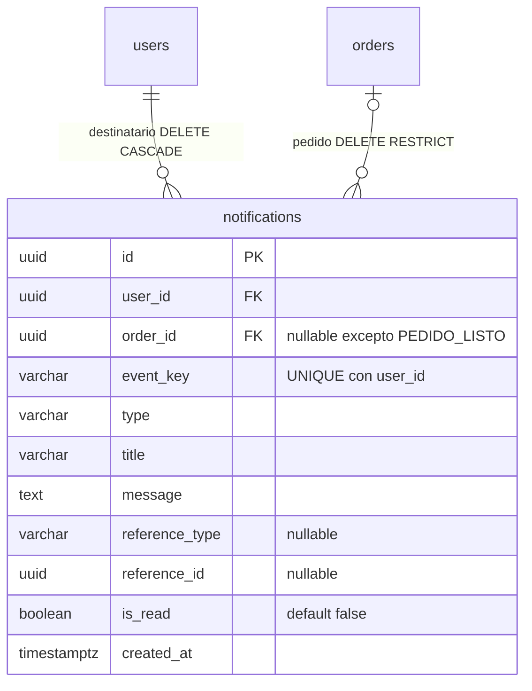

# Diagrama ER

Modelo vigente del catálogo por sucursal (DB-01), del inventario de insumos (DB-05), de las reseñas por pedido (DB-06) y de los parámetros de sucursal (DB-11). Las demás tasks de datos agregan aquí sus entidades. Las reglas y justificaciones están en [modelo-datos.md](modelo-datos.md).

```mermaid
erDiagram
    branches ||--o{ categories : "tiene"
    branches ||--o{ dishes : "ofrece"
    branches |o--o{ users : "asigna personal"
    branches ||--o{ orders : "registra"
    branches ||--o{ reviews : "recibe"
    categories ||--o{ dishes : "agrupa (misma sucursal)"
    branches ||--o{ branch_ingredients : "tiene existencias"
    ingredients ||--o{ branch_ingredients : "se registra en"
    branches ||--o| branch_configs : "tiene"
    users |o--o{ branch_configs : "cambió por última vez"
    users ||--o{ orders : "realiza"
    users ||--o{ reviews : "escribe"
    orders ||--|| reviews : "tiene, como máximo una"

    branches {
        uuid id PK
        varchar name UK
        varchar address
        varchar time_zone
        boolean is_active
        timestamptz created_at
    }
    branch_configs {
        uuid id PK
        uuid branch_id FK,UK "DELETE CASCADE"
        boolean is_open "DEFAULT true"
        uuid updated_by FK "opcional, DELETE SET NULL"
        timestamptz created_at
        timestamptz updated_at
    }
    users {
        uuid id PK
        text email UK
        enum role
        uuid branch_id FK "nulo para cliente y gerente general"
        boolean is_active
    }
    categories {
        uuid id PK
        uuid branch_id FK
        varchar name "UNIQUE con branch_id"
        integer display_order
        text description
        boolean is_active
        timestamptz created_at
        timestamptz updated_at
    }
    dishes {
        uuid id PK
        uuid branch_id FK
        uuid category_id FK "FK compuesta con branch_id"
        varchar name "UNIQUE con branch_id"
        varchar description
        numeric price "NUMERIC(10,2), mayor que 0"
        text image_url
        enum status "se conserva hasta BE-01"
        boolean is_available
        boolean is_deleted
        timestamptz created_at
        timestamptz updated_at
    }
    orders {
        uuid id PK
        uuid branch_id FK
        uuid customer_id FK "nullable"
        uuid account_id FK "nullable"
        enum status
        enum type
        numeric total "NUMERIC(14,2), no negativo"
        varchar order_number "UNIQUE con branch_id"
        uuid operation_id UK
        timestamptz created_at
        timestamptz updated_at
    }
    reviews {
        uuid id PK
        uuid order_id UK FK
        uuid customer_id FK
        uuid branch_id FK
        integer rating "CHECK 1..5"
        text comment
        timestamptz created_at
    }
    ingredients {
        uuid id PK
        varchar name UK
        varchar unit
        boolean is_active
    }
    branch_ingredients {
        uuid id PK
        uuid branch_id FK "DELETE RESTRICT"
        uuid ingredient_id FK "UNIQUE con branch_id"
        numeric current_stock "NUMERIC(14,3), mayor o igual a 0"
        numeric minimum_stock "NUMERIC(14,3), mayor o igual a 0"
        boolean is_active
        timestamptz created_at
        timestamptz updated_at
    }
```

Índices del catálogo: `dishes(branch_id, category_id)`, `categories(branch_id, name)` y `dishes(branch_id, name)`. El par `categories(branch_id, id)` es único para que la FK compuesta impida un platillo en una categoría de otra sucursal.

Índice del inventario: `branch_ingredients(branch_id, current_stock)`. El stock bajo se calcula y no se guarda. Las reglas están en [inventario-insumos.md](inventario-insumos.md).

Índices de reseñas: `reviews(branch_id, created_at)`, `reviews(customer_id, created_at)` y `reviews_order_id_key` como unicidad por pedido. El promedio de рейтин por sucursal o por pedido se calcula con `AVG(rating)` en agregación a demanda; no se persiste un campo `average_rating` ni `review_count` para evitar duplicar datos derivados.

## DB-09: notificaciones internas

`Notification.userId` (`user_id`) equivale a `recipientId` del PDF. Se conserva por compatibilidad con NotificationRepository. BE-09 obtiene el destinatario de Order.customerId y verifica que sea el dueño del pedido. La sucursal se obtiene de Order.branchId.



Clave de aviso: `PEDIDO_LISTO:<orderId>:<userId>`. UNIQUE(user_id,event_key) evita duplicados incluso si el aviso ya fue leído. Para PEDIDO_LISTO, el CHECK exige pedido y clave no nulos y la coincidencia exacta de esa identidad. Otros tipos conservan las referencias genéricas existentes. La migración rechaza duplicados y avisos PEDIDO_LISTO sin pedido sin cambios parciales ni borrado automático.

Índices agregados: (user_id,created_at), (order_id). Se conserva (user_id,is_read,created_at). El estado vacío corresponde a cero filas, sin registros artificiales.

Seed: `npm run db:seed:notifications`. Requiere ejecutar antes los seeds base y catálogo. Reutiliza demo@example.com y BASE_BRANCHES; agrega en cada sucursal el pedido DB09-READY, con estado READY, una línea de dos ramen y total decimal calculado de su precio. No crea clientes ni sucursales. Los reintentos conservan los mismos pedidos, líneas y avisos.

`down.sql` rechaza la reversión si hay notificaciones con order_id no nulo para evitar perder su asociación. Deben respaldarse y retirarse explícitamente antes de revertir. Si no hay asociaciones, retira las restricciones y la columna order_id.
