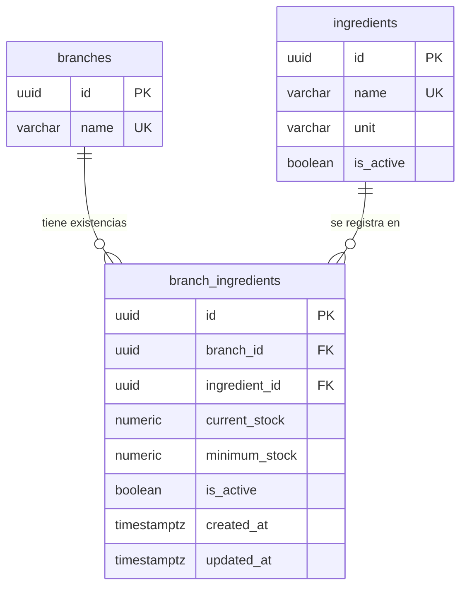

# Inventario de insumos — DB-05

DB-05 (HU-05) describe un `InventoryItem (id, branchId, name, unit, currentStock, minimumStock)`. No se crea esa tabla: `Ingredient` y `BranchIngredient` ya guardan esos datos, y `purchase_details` e `inventory_movements` apuntan a `branch_ingredients`. Una tabla nueva duplicaría las existencias; renombrar el modelo obligaría a tocar `src/inventory` y `src/purchases` sin cambiar el comportamiento.

| Campo de DB-05 | Columna                                           |
| -------------- | ------------------------------------------------- |
| id             | `branch_ingredients.id`                           |
| branchId       | `branch_ingredients.branch_id`                    |
| name           | `ingredients.name`, mediante `ingredient_id`      |
| unit           | `ingredients.unit`, mediante `ingredient_id`      |
| currentStock   | `branch_ingredients.current_stock`, NUMERIC(14,3) |
| minimumStock   | `branch_ingredients.minimum_stock`, NUMERIC(14,3) |

## Restricciones

| Modelo / campo                           | Restricción y justificación                                                                                       |
| ---------------------------------------- | ----------------------------------------------------------------------------------------------------------------- |
| BranchIngredient.currentStock            | CHECK `branch_ingredients_current_stock_check`: mayor o igual a 0 y distinto de NaN                               |
| BranchIngredient.minimumStock            | CHECK `branch_ingredients_minimum_stock_check`: mayor o igual a 0 y distinto de NaN                               |
| BranchIngredient.branchId                | FK `branch_ingredients_branch_id_fkey` con DELETE RESTRICT: borrar una sucursal no debe borrar sus existencias    |
| BranchIngredient.branchId + ingredientId | UNIQUE `branch_ingredients_branch_id_ingredient_id_key`: un registro de existencias por insumo y sucursal         |
| BranchIngredient.createdAt               | TIMESTAMPTZ(6) NOT NULL DEFAULT now                                                                               |
| BranchIngredient.updatedAt               | TIMESTAMPTZ(6) NOT NULL DEFAULT now; `@updatedAt` lo actualiza desde Prisma                                       |
| Ingredient.name                          | UNIQUE `ingredients_name_key`: el índice por sucursal y nombre se perdió al mover el stock a `branch_ingredients` |

El índice por sucursal que pide DB-05 ya existe: `branch_ingredients_branch_id_current_stock_idx` empieza por `branch_id`, así que no se agrega otro.

## Decisiones

- **NaN.** `NUMERIC(14,3)` admite NaN y PostgreSQL lo ordena por encima de cualquier número, de modo que `>= 0` lo aceptaría. Por eso los CHECK también lo excluyen.
- **Stock bajo.** No se guarda: BE-05 lo calcula como `currentStock <= minimumStock`.
- **Código de error al borrar.** Con PostgreSQL 18, un DELETE rechazado por RESTRICT responde SQLSTATE `23001` (`restrict_violation`), no `23503`; este último solo aplica al insertar una referencia inexistente.
- **`updated_at`.** Lo actualiza Prisma; una escritura con SQL directo debe asignarlo por su cuenta.
- **Catálogo global.** `Ingredient` se comparte entre sucursales, por lo que nombre y unidad son iguales en todas. La comparación de nombres conserva las reglas de texto de PostgreSQL, sin normalizar mayúsculas.
- **Datos existentes.** La migración falla si hay cantidades negativas o NaN, o nombres de insumo repetidos: no los corrige ni los combina. Las filas existentes reciben la fecha de la migración en `created_at` y `updated_at`, porque no hay una fecha real que conservar.

## Límite del MVP

El inventario es de consulta. Según HU-05 no hay descuento por receta, ingresos ni órdenes de compra: crear un pedido no cambia las existencias. `Recipe`, `Purchase` e `InventoryMovement` se conservan sin cambios y sin uso en esta historia.

## Diagrama ER



## Datos iniciales

`npm run db:seed:inventory` ejecuta primero el seed base y agrega cuatro insumos a Centro y Santa Tecla, con valores distintos por sucursal. Cada sucursal tiene casos por debajo, igual y por encima del mínimo, y Centro incluye uno con stock cero. Solo inserta lo que falta, así que repetirlo no cambia existencias ni fechas.

## Reversión

Se revierte antes que las demás migraciones propias. Restaura el DELETE CASCADE y quita los CHECK, el UNIQUE y las dos columnas de fecha, cuyos valores se pierden.

```powershell
npx prisma db execute --file prisma/migrations/20261105120000_inventario_insumos/down.sql
npx prisma db execute --file prisma/migrations/20261105120000_inventario_insumos/migration.sql
```
