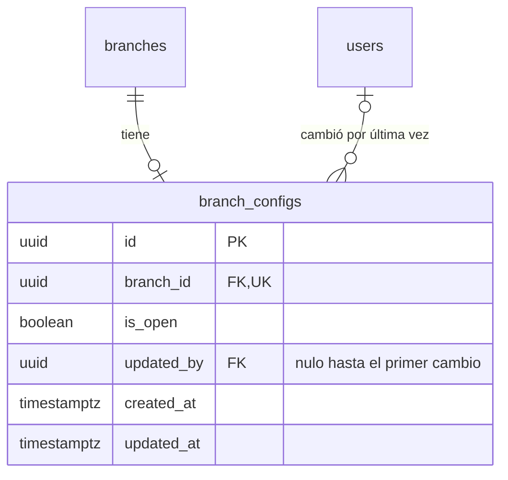

# Parámetros de sucursal — DB-11

`BranchConfig` guarda si una sucursal recibe pedidos y quién cambió ese estado por última vez. Se separa de `Branch` para que la auditoría operativa no se mezcle con los datos de la sucursal.

| Campo     | Restricción y justificación                                                             |
| --------- | --------------------------------------------------------------------------------------- |
| branchId  | UUID obligatorio, UNIQUE `branch_configs_branch_id_key`: una configuración por sucursal |
| branchId  | FK `branch_configs_branch_id_fkey` con DELETE CASCADE: no tiene sentido sin su sucursal |
| isOpen    | BOOLEAN NOT NULL DEFAULT true: true es ABIERTA y false es CERRADA                       |
| updatedBy | UUID opcional, FK `branch_configs_updated_by_fkey` a users con DELETE SET NULL          |
| createdAt | TIMESTAMPTZ(6) NOT NULL DEFAULT now                                                     |
| updatedAt | TIMESTAMPTZ(6) NOT NULL DEFAULT now; `@updatedAt` lo actualiza desde Prisma             |

## Decisiones

- **`isOpen` frente a `Branch.isActive`.** Son conceptos distintos: una sucursal inactiva deja de existir para el público y su menú responde 404; una sucursal cerrada sigue mostrando su menú, pero no recibe pedidos.
- **Booleano en lugar de enum.** La HU modela el estado con `isOpen` y solo admite dos valores. ABIERTA y CERRADA son la presentación de ese campo.
- **`updatedBy` nulo.** Significa que nadie ha cambiado el estado inicial. Al eliminar un usuario el estado se conserva y el autor queda nulo. La base no valida que el autor pertenezca a la sucursal: esa regla es de BE-11.
- **Datos existentes.** La migración crea una configuración abierta por cada sucursal, porque hoy todas aceptan pedidos.
- **Sucursales nuevas.** No se crea la configuración con un trigger, porque el MVP no tiene alta de sucursales: se preparan por seed.
- **Horarios fuera de alcance.** `openingTime` y `closingTime` son opcionales en DB-11 y la configuración avanzada de horarios está fuera del MVP, por lo que no se agregan.
- **Validación de pedidos.** Consultar `isOpen` dentro de la transacción de alta corresponde a BE-02. El endpoint de cambio y la consulta pública corresponden a BE-11.

## Diagrama ER



`docs/decisiones/diagrama-er.md` se crea en DB-01, que aún no está en `develop`. Cuando se integre, este fragmento debe pasar a ese archivo.

## Datos iniciales

`npm run db:seed:branch-config` ejecuta primero el seed base y crea una configuración abierta y sin autor para Centro y Santa Tecla, mediante upsert por `branchId`. Repetirlo no cambia estados, autores ni fechas.

## Reversión

Su `down.sql` retira la tabla y pierde el estado y la auditoría guardados; al reaplicar la migración todas las sucursales vuelven a quedar abiertas.

```powershell
npx prisma db execute --file prisma/migrations/20261105050000_parametros_sucursal/down.sql
npx prisma db execute --file prisma/migrations/20261105050000_parametros_sucursal/migration.sql
```

## Verificación

Con `DATABASE_URL` apuntando a una base de pruebas del PostgreSQL de Docker:

```bash
npm run prisma:deploy
npm run prisma:generate
npm run test:db
npm run test:migrations
```

`test/db-branch-config.e2e-spec.ts` comprueba las restricciones, la conservación del estado y el registro de autor y fecha. Sus pruebas de seed confirman escrituras, así que dejan los datos base y las configuraciones en la base de `DATABASE_URL`; lo que modifican se restaura al terminar. El verificador de migraciones comprueba además que cada sucursal existente quede abierta y sin autor.
