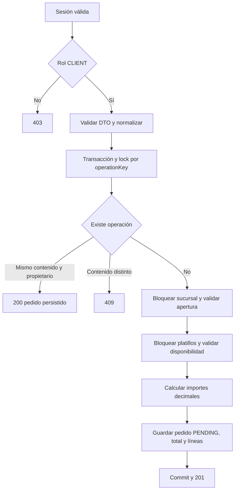

# BE-02: pedidos para llevar

## Contrato

`POST /api/v1/orders` requiere sesión válida y rol persistido `CLIENT`
(equivalente a CLIENTE). El guard existente relee al usuario desde la base;
`OrdersService` aplica el permiso antes de acceder a persistencia.

```json
{
  "branchId": "10000000-0000-4000-8000-000000000001",
  "operationKey": "20000000-0000-4000-8000-000000000001",
  "lines": [
    { "dishId": "30000000-0000-4000-8000-000000000001", "quantity": 2 }
  ]
}
```

UUID obligatorios; de 1 a 100 líneas distintas y cantidades enteras de 1 a 20,
compatibles con la restricción existente de PostgreSQL. Se rechazan campos
adicionales, incluidos propietario, precio, total, rol y estado.

Respuesta: `id`, `branchId`, `operationKey`, `status`, `total`, `lines`.
Cada línea incluye `dishId`, `name`, `quantity`, `unitPrice`, `subtotal`.
Los importes son strings con dos decimales; se calculan con Prisma.Decimal.
El estado inicial persistido es `PENDING`, equivalente a PENDIENTE.
Crear no aprueba ni registra un pago. La modalidad interna es ONLINE, requerida
por la restricción existente de pedidos TAKEOUT; no cambia el estado inicial PENDING.

- 201: nuevo pedido.
- 200: reintento de la misma operación con contenido semánticamente idéntico.
- 400: DTO inválido o campos adicionales.
- 401: sesión ausente, vencida o inválida.
- 403: usuario autenticado sin rol CLIENT.
- 404: sucursal inexistente.
- 409: sucursal inactiva/cerrada/sin configuración, platillo ajeno o no disponible,
  categoría inactiva o clave utilizada con otro contenido/propietario.

## Idempotencia y concurrencia

`operationKey` se guarda en `Order.operationId`, cuya unicidad ya existe.
Una huella SHA-256 guarda propietario, sucursal, clave y líneas normalizadas por
UUID y orden. Cambiar el orden de las líneas o las mayúsculas de un UUID no
crea un pedido nuevo. Las líneas duplicadas no son válidas.

La transacción toma un advisory lock de PostgreSQL por clave antes de consultar
el pedido existente. Una solicitud simultánea con la misma clave espera y luego
reutiliza el pedido o recibe 409. Los importes históricos y el total almacenado
se devuelven sin recalcular cuando se repite la operación, incluso si después
cambia el menú o se cierra la sucursal. No se expone un pedido de otro cliente.

La misma transacción bloquea sucursal y configuración con FOR SHARE y comprueba
isOpen. El PATCH de BE-11 actualiza esa misma fila y debe esperar a que termine
un pedido ya autorizado; un pedido que espera un cierre confirmado lee el estado
cerrado y falla. Los platillos y categorías también se bloquean durante la lectura
de precios y disponibilidad. Se filtra por sucursal, isAvailable, isDeleted,
Dish.status y Category.isActive. No se consulta ni descuenta inventario real.

## Persistencia y compatibilidad

Migración nueva `20261106190000_order_totals_idempotency`:

- Order.total: NUMERIC(14,2), no negativo.
- Order.requestHash: VARCHAR(64).
- OrderItem.unitPrice pasa a NUMERIC(10,2), igual que Dish.price.

Las columnas nuevas son nulas para pedidos anteriores: no se inventan huellas
ni totales de operaciones previas. El endpoint nuevo siempre guarda ambos.
Una clave de un pedido anterior no se reutiliza desde este contrato (409).
La reversión reduce la precisión de unitPrice; si hay importes que exceden la
precisión anterior, PostgreSQL la rechazará y habrá que planificar el tratamiento
de esos datos antes de revertir. No se borran datos automáticamente.

La rama parte de develop, sin incluir BE-01 ni la antigua rama
feat/be-2.2.1-pedido-llevar. No se integra su contrato en español ni sus cambios
de modalidad de pago. Los módulos de pagos y cocina deben consumir el estado y
las líneas persistidas, coordinando sus contratos en sus respectivas tareas.

## Flujo



## Validación del 6 de noviembre de 2026

- 21 pruebas de servicio/HTTP con guard JWT real y repositorio simulado aprobadas.
- Lint de `src/orders` y `test/db-orders.e2e-spec.ts`: sin incidencias.
- `npm run test:migrations`: aplicación, reversión y reaplicación correctas,
  incluyendo la migración nueva, en PostgreSQL temporal.
- Se añaden seis casos con AppModule y PostgreSQL reales: persistencia,
  reintentos, conflictos, solicitudes simultáneas, rollback y cierre concurrente.
  La suite falla al inicializar por Prisma Client ausente; seis casos omitidos.
- Compilación bloqueada por el cliente ausente. No se han validado todavía el
  repositorio Prisma ni el endpoint completo contra PostgreSQL.
- La descarga de Prisma desde binaries.prisma.sh sigue recibiendo HTTP 403.
  No se deshabilitaron TLS ni checksums.

Tras habilitar la descarga, usar una base exclusiva de pruebas:

```bash
npm ci
npm run prisma:deploy
npm run build
npm run lint
npm test
npx vitest run --config vitest.config.e2e.ts test/db-orders.e2e-spec.ts
npm run test:migrations
```

Rama: feat/BE-02-orders. Destino: develop. El usuario crea el PR y asigna reviewer.
